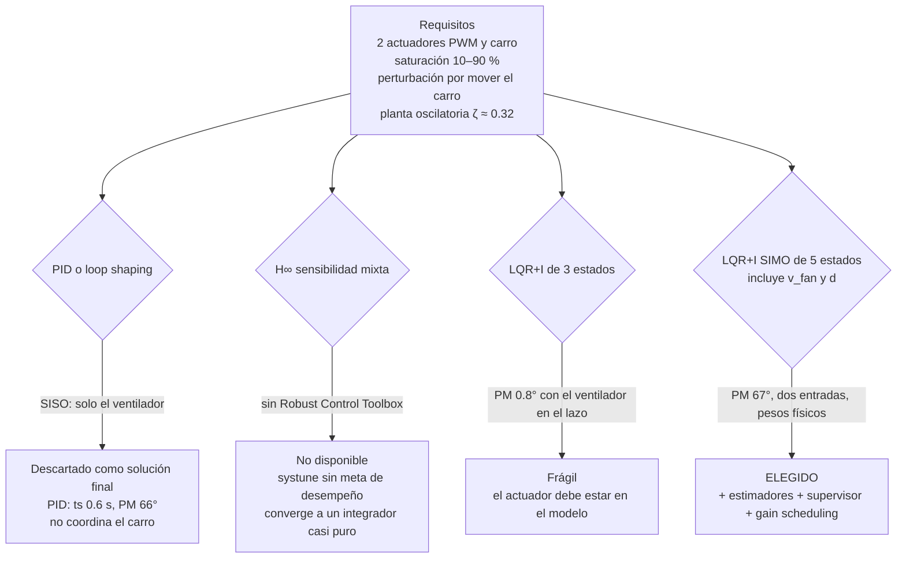
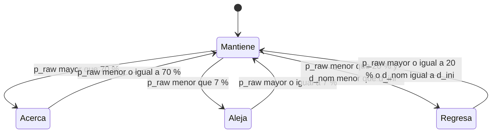
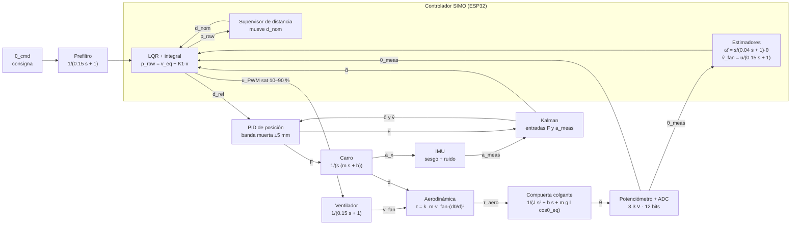
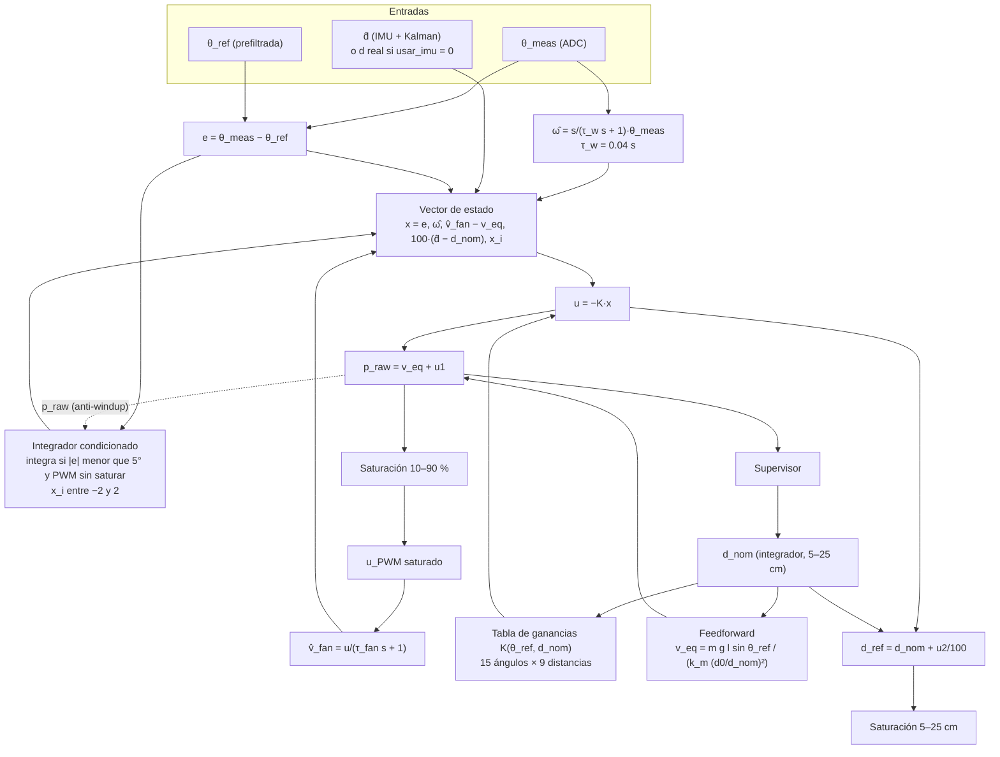
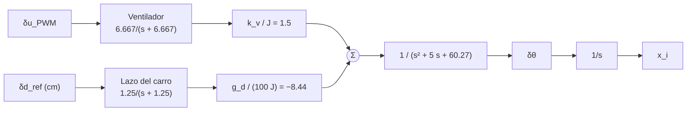

# Documentación técnica: modelado, funciones de transferencia y control LQR

> Proyecto **Car_Control**: control del ángulo de una compuerta colgante mediante un ventilador montado sobre un carro móvil.
> Todo lo que aquí se documenta está implementado y verificado en `init_parametros.m`, `modelo_miso_compuerta.slx`, `lqr_simo.m`, `simular_sistema.m` y `sintonizar_loop_shaping.m`. Los valores numéricos salen de esos archivos, no de estimaciones.

## Contenido

1. [Descripción del sistema y convenciones](#1-descripción-del-sistema-y-convenciones)
2. [Ecuaciones primitivas](#2-ecuaciones-primitivas)
3. [Linealización y funciones de transferencia](#3-linealización-y-funciones-de-transferencia)
4. [Cómo se llegó al LQR como mejor opción](#4-cómo-se-llegó-al-lqr-como-mejor-opción)
5. [Estrategia de control LQR](#5-estrategia-de-control-lqr)
6. [Diagramas de bloques (Mermaid)](#6-diagramas-de-bloques-mermaid)
7. [Verificación y reproducibilidad](#7-verificación-y-reproducibilidad)
8. [Puesta en marcha de los ESP32](#8-puesta-en-marcha-de-los-esp32)
9. [Limitaciones y trabajo futuro](#9-limitaciones-y-trabajo-futuro)

---

## 1. Descripción del sistema y convenciones

### 1.1 Montaje físico

* La compuerta cuelga de un **soporte en L invertida** (poste vertical con un brazo horizontal). El pivote, con el potenciómetro, está en la punta del brazo: la compuerta queda **suspendida**, sin tocar el suelo.
* El **ventilador va sobre el chasis del carro** y sopla horizontalmente hacia la compuerta. El carro avanza o retrocede por el suelo y así cambia la distancia $d$ entre la salida del ventilador y la posición de reposo de la compuerta.
* Es un sistema **SIMO** (una medición, dos acciones de control): se mide solo el ángulo $\theta$ (potenciómetro), y se actúa con el ciclo de trabajo del ventilador ($u_{PWM}$) y con la posición deseada del carro ($d_{ref}$). El carro lleva una IMU que permite estimar $d$.

### 1.2 Convenciones

| Símbolo | Significado | Convención |
|---|---|---|
| $\theta$ | Ángulo de la compuerta | $0^\circ$ = colgando en reposo; el aire la empuja alejándola del carro; $180^\circ$ = vertical hacia arriba |
| $d$ | Distancia carro–compuerta | Medida desde la posición de reposo de la compuerta hasta la salida del ventilador; $d \in [5, 25]\text{ cm}$ |
| $x$ | Avance del carro | Positivo = hacia la compuerta; $d = d_{ini} - x$ |
| $u_{PWM}$ | Orden de ciclo de trabajo | Saturada en $`[10\%, 90\%]`$ |
| $v_{fan}$ | Estado del ventilador | Sigue a $u_{PWM}$ con constante $\tau_{fan}$; $`\in [0, 90]\%`$ |

### 1.3 Parámetros del modelo

| Parámetro | Valor | Origen |
|---|---|---|
| Masa de la compuerta $m_g$ | $0.015\text{ kg}$ | Medida (cartón 15 × 20 cm) |
| Largo $L$ / brazo del centro de masa $\ell_c$ | $0.20\text{ m}$ / $0.10\text{ m}$ | Geometría |
| Inercia $J = \tfrac13 m_g L^2$ | $2\times10^{-4}\text{ kg·m}^2$ | Calculada (varilla uniforme respecto de un extremo) |
| Amortiguamiento viscoso $b_c$ | $10^{-3}\text{ N·m·s/rad}$ | Supuesto |
| Fricción de Coulomb $\tau_f$ | $10^{-4}\text{ N·m}$ | Supuesto |
| Constante aerodinámica $k_m$ | $`3\times10^{-4}\text{ N·m/\%}`$ a $d_0 = 10\text{ cm}$ | **Supuesto: calibrar con el ventilador real** |
| Constante de tiempo del ventilador $\tau_{fan}$ | $0.15\text{ s}$ | Supuesto |
| Masa del carro $m$ / fricción $b$ / empuje máx. $F_{max}$ | $0.421\text{ kg}$ / $3.5\text{ N·s/m}$ / $3.0\text{ N}$ | Hoja de datos de los motorreductores |
| IMU: sesgo / densidad de ruido / periodo | $0.02\text{ m/s}^2$ / $10^{-5}\text{ (m/s}^2)^2\text{·s}$ / $10\text{ ms}$ | Supuesto (MPU6050) |
| Potenciómetro | $3.3\text{ V}$ ↔ $180^\circ$ ($K_{pot} = 0.01833\text{ V/}^\circ$) | Directo al ADC de 12 bits ($0.044^\circ$/LSB) |

---

## 2. Ecuaciones primitivas

### 2.1 Compuerta (péndulo colgante): derivación por Lagrange

Coordenada generalizada: $\theta$ (desvío desde el reposo colgante). Con el pivote a una altura $H$, el centro de masa está en

```math
\begin{aligned}
x_{cm} &= -\ell_c \sin\theta \\[4pt]
y_{cm} &= H - \ell_c\cos\theta
\end{aligned}
```

Energía cinética y potencial:

```math
\begin{aligned}
T &= \tfrac12 J\dot\theta^2 \\[4pt]
U &= m_g g\, y_{cm} = -m_g g \ell_c \cos\theta + \text{cte}
\end{aligned}
```

La ecuación de Lagrange $\dfrac{d}{dt}\dfrac{\partial T}{\partial\dot\theta} - \dfrac{\partial T}{\partial\theta} + \dfrac{\partial U}{\partial\theta} = Q_{nc}$ con las fuerzas no conservativas (aire, fricción viscosa, fricción seca y perturbación externa) da:

```math
\boxed{\,J\ddot\theta + m_g g \ell_c \sin\theta = \tau_{aero} - b_c\dot\theta - \tau_f\,\mathrm{sgn}(\dot\theta) + \tau_{ext}\,}
```

* El término $m_g g \ell_c \sin\theta$ es **restaurador**: la gravedad devuelve la compuerta a $\theta = 0$. Por eso la planta es **estable** (en una versión anterior se había modelado con $\cos\theta$ y daba una planta inestable; la convención colgante lo corrigió).
* En simulación $\mathrm{sgn}(\dot\theta)$ se suaviza como $`\tanh(50\,\dot\theta)`$, y hay topes inelásticos en $0^\circ$ y $90^\circ$ (`theta_max` $= \pi/2$): $`\ddot\theta_{ef} = \max(\ddot\theta,\,-\dot\theta/\tau_{stop})`$ en el tope inferior.

### 2.2 Torque aerodinámico

El ventilador genera un chorro de velocidad axial $v_0$ en su salida. A una distancia $d$ el chorro libre turbulento se ensancha y su velocidad en el eje decae aproximadamente como $`v_j(d) \approx v_0\, d_0/d`$. La compuerta, más pequeña que la sección del chorro, recibe una fuerza de impulso

```math
\begin{aligned}
F &= \tfrac12\rho\, C_d\, A_g\, v_j(d)^2 = F_0\left(\frac{d_0}{d}\right)^2 \\[6pt]
\tau_{aero} &= F\,\ell_a
\end{aligned}
```

con $\ell_a$ el brazo de aplicación de la fuerza. **Simplificación adoptada:** se agrupan $\tfrac12\rho C_d A_g \ell_a$ y la relación velocidad–PWM del ventilador en una sola constante $k_m$, lineal en el estado del ventilador:

```math
\boxed{\,\tau_{aero} = k_m\, v_{fan}\left(\frac{d_0}{d}\right)^2\,}
```

Esta forma es una aproximación (la física real es cuadrática en la velocidad del chorro). La dependencia $1/d^2$ es la que hace que mover el carro sirva como segundo actuador: acercarlo multiplica el torque disponible por $(d_0/d)^2$. $k_m$ debe calibrarse experimentalmente.

### 2.3 Ventilador y saturación

```math
\tau_{fan}\,\dot v_{fan} + v_{fan} = \mathrm{sat}_{[10,\,90]}(u_{PWM})
```

### 2.4 Carro

Segunda ley de Newton con fricción lineal, con $x$ positivo hacia la compuerta:

```math
\begin{aligned}
m\,\ddot x &= F - b\,\dot x \\[4pt]
F &= \frac{u_{car}}{100}\,F_{max} \\[4pt]
d &= d_{ini} - x
\end{aligned}
```

El lazo de posición del carro es un PID con **banda muerta de $\pm 5\text{ mm}$** sobre el error $e_a = \hat d - d_{ref}$ (positivo = hay que avanzar), con la derivada tomada sobre la velocidad estimada:

```math
u_{car} = \mathrm{sat}_{[-100,\,100]}\!\left(K_{p}\,e_a + K_{i}\!\int e_a\,dt - K_{d}\,\hat v\right)
```

Ganancias (de `init_parametros.m`):

| Ganancia | Valor |
|---|---|
| $K_p$ | $`130\ \%/\text{m}`$ |
| $K_i$ | $`10\ \%/(\text{m·s})`$ |
| $K_d$ | $`5\ \%\cdot\text{s/m}`$ |

### 2.5 Sensores y estimadores

**Ángulo.** El potenciómetro entrega $`V = K_{pot}\,\theta^\circ`$ (saturado en $[0, 3.3]\text{ V}$) y el ADC de 12 bits lo cuantiza con paso $q = 3.3/4095$; el ángulo medido es $`\theta_{meas} = \mathrm{round}(V/q)\,q/K_{pot}`$ (resolución $0.044^\circ$).

**Velocidad angular.** No se mide; se estima con una derivada filtrada de la medida del ADC:

```math
\hat\omega(s) = \frac{s}{\tau_w s + 1}\,\theta_{meas}(s)
```

con $\tau_w = 0.04\text{ s}$.

**Distancia (IMU + Kalman).** La IMU mide $a_{meas} = \ddot x + b_a + n_a$ (aceleración + sesgo + ruido). Con el estado $\xi = [v,\ b_a]^T$ y la fuerza de tracción $F$ como entrada conocida:

```math
\begin{aligned}
\dot\xi &= A_o\,\xi + B_o\,F \\[4pt]
a_{meas} &= C_o\,\xi + D_o\,F
\end{aligned}
```

con las matrices del modelo del carro:

```math
\begin{aligned}
A_o &= \begin{bmatrix}-b/m & 0\\ 0 & 0\end{bmatrix} &
B_o &= \begin{bmatrix}1/m\\ 0\end{bmatrix} \\[10pt]
C_o &= \begin{bmatrix}-b/m & 1\end{bmatrix} &
D_o &= \frac{1}{m}
\end{aligned}
```

El observador corrige el modelo con el error entre la aceleración medida y la estimada, y la distancia se obtiene integrando la velocidad estimada:

```math
\begin{aligned}
\dot{\hat\xi} &= A_o\hat\xi + B_oF + L\,\big(a_{meas} - C_o\hat\xi - D_oF\big) \\[6pt]
\hat d &= d_{ini} - \int \hat v\,dt
\end{aligned}
```

Datos del observador:

* Ganancia: $L = [-18.07,\ 31.62]^T$, calculada con `lqe`.
* Covarianzas: $Q_n = \mathrm{diag}(0.5,\ 1)$ y $R = 10^{-3}$.
* Polos del observador: $-188.7$ y $-1.39$ rad/s.
* **Limitación:** sin una medición de posición, el error de $\hat d$ no se anula, solo queda acotado (un offset constante del orden de 1–2 mm).

### 2.6 Sistema no lineal completo

```math
\begin{aligned}
J\ddot\theta &= k_m\, v_{fan}\left(\frac{d_0}{d}\right)^2 - m_g g\ell_c\sin\theta - b_c\dot\theta - \tau_f\tanh(50\dot\theta) + \tau_{ext} \\[8pt]
\tau_{fan}\dot v_{fan} &= \mathrm{sat}_{[10,\,90]}(u_{PWM}) - v_{fan} \\[8pt]
m\ddot x &= \frac{u_{car}}{100}F_{max} - b\dot x \\[8pt]
d &= d_{ini} - x \\[8pt]
\theta_{meas} &= Q_{ADC}\big(K_{pot}\theta\big)/K_{pot}
\end{aligned}
```

---

## 3. Linealización y funciones de transferencia

### 3.1 Punto de equilibrio

En equilibrio ($\dot\theta = \ddot\theta = 0$) el torque del aire iguala al de la gravedad, lo que fija el PWM necesario para sostener un ángulo $\theta_{eq}$ a una distancia $d_{eq}$:

```math
v_{eq} = \frac{m_g g \ell_c \sin\theta_{eq}}{k_m\,(d_0/d_{eq})^2}
```

Para $\theta_{eq} = 35^\circ$ y $d_{eq} = 10\text{ cm}$ (entonces $d_0/d_{eq} = 1$):

```math
v_{eq} = \frac{0.015 \cdot 9.81 \cdot 0.10 \cdot \sin 35^\circ}{3\times10^{-4}}
       = \frac{8.44\times10^{-3}}{3\times10^{-4}}
       = 28.1\ \%
```

Con el PWM mínimo de $`10\,\%`$ el ventilador ya empuja de más por debajo de este ángulo (a $10\text{ cm}$):

```math
\sin\theta_{min} = \frac{10\,k_m}{m_g g\ell_c} = \frac{10 \cdot 3\times10^{-4}}{0.0147} = 0.204
\quad\Rightarrow\quad
\theta_{min} \approx 11.8^\circ
```

* Para ángulos menores que $\theta_{min}$ hay que **alejar** el carro.
* Si $v_{eq}$ superara el $`90\,\%`$ (carro demasiado lejos) hay que **acercarlo**.
* Las dos cosas las hace el supervisor (§5.8).

### 3.2 Linealización

Con $\theta = \theta_{eq} + \delta\theta$, $d = d_{eq} + \delta d$ y $v_{fan} = v_{eq} + \delta v$:

```math
\begin{aligned}
\sin(\theta_{eq}+\delta\theta) &\approx \sin\theta_{eq} + \cos\theta_{eq}\,\delta\theta \\[8pt]
\left(\frac{d_0}{d}\right)^2 &\approx \left(\frac{d_0}{d_{eq}}\right)^2 - \frac{2d_0^2}{d_{eq}^3}\,\delta d
\end{aligned}
```

Sustituyendo en la ecuación de la compuerta y quitando el equilibrio:

```math
\boxed{\,J\,\delta\ddot\theta = -m_g g\ell_c\cos\theta_{eq}\,\delta\theta - b_c\,\delta\dot\theta + k_v\,\delta v + g_d\,\delta d\,}
```

con

```math
\begin{aligned}
k_v &= k_m\left(\frac{d_0}{d_{eq}}\right)^2 = 3\times10^{-4}\ \text{N·m}/\% \\[8pt]
g_d &= -\frac{2\,k_m\,v_{eq}\,d_0^2}{d_{eq}^3} = -\frac{2 \cdot 3\times10^{-4} \cdot 28.1 \cdot 0.10^2}{0.10^3} = -0.169\ \text{N·m/m}
\end{aligned}
```

El signo de $g_d$ es negativo: aumentar $d$ (alejar el carro) reduce el torque. El término gravitacional $-m_g g\ell_c\cos\theta_{eq}/J$ es una **rigidez restauradora** (autovalores con parte real negativa).

### 3.3 Modelo en espacio de estados (5 estados, 2 entradas)

```math
x = \begin{bmatrix}\delta\theta\\ \delta\omega\\ \delta v\\ \delta d\\ x_i\end{bmatrix}
\qquad\qquad
u = \begin{bmatrix}\delta u_{PWM}\\ \delta d_{ref}\end{bmatrix}
```

donde $x_i$ es la integral del error de ángulo: $\dot x_i = \delta\theta$.

El lazo interno del carro se modela como un primer orden $\delta\dot d = (\delta d_{ref} - \delta d)/\tau_{car}$ con $\tau_{car} = 0.8\text{ s}$ (el lazo real responde con $`\tau_{63\%} \approx 0.94\text{ s}`$ y sobrepico de 0.2 %). Con $\delta d$ en **cm**:

```math
\dot x = A\,x + B\,u
```

```math
A = \begin{bmatrix}
0 & 1 & 0 & 0 & 0 \\[6pt]
-\dfrac{m_g g\ell_c\cos\theta_{eq}}{J} & -\dfrac{b_c}{J} & \dfrac{k_v}{J} & \dfrac{g_d}{100\,J} & 0 \\[12pt]
0 & 0 & -\dfrac{1}{\tau_{fan}} & 0 & 0 \\[12pt]
0 & 0 & 0 & -\dfrac{1}{\tau_{car}} & 0 \\[6pt]
1 & 0 & 0 & 0 & 0
\end{bmatrix}
```

```math
B = \begin{bmatrix}
0 & 0 \\[6pt]
0 & 0 \\[6pt]
\dfrac{1}{\tau_{fan}} & 0 \\[12pt]
0 & \dfrac{1}{\tau_{car}} \\[6pt]
0 & 0
\end{bmatrix}
```

Cálculo de cada término en $\theta_{eq} = 35^\circ$, $d_{eq} = 10\text{ cm}$:

```math
\begin{aligned}
A_{21} &= -\frac{m_g g\ell_c\cos\theta_{eq}}{J} = -\frac{0.015 \cdot 9.81 \cdot 0.10 \cdot \cos 35^\circ}{2\times10^{-4}} = -60.27 \\[10pt]
A_{22} &= -\frac{b_c}{J} = -\frac{10^{-3}}{2\times10^{-4}} = -5 \\[10pt]
A_{23} &= \frac{k_v}{J} = \frac{3\times10^{-4}}{2\times10^{-4}} = 1.5 \\[10pt]
A_{24} &= \frac{g_d}{100\,J} = \frac{-0.169}{100 \cdot 2\times10^{-4}} = -8.44 \\[10pt]
A_{33} &= -\frac{1}{\tau_{fan}} = -\frac{1}{0.15} = -6.667 \\[10pt]
A_{44} &= -\frac{1}{\tau_{car}} = -\frac{1}{0.8} = -1.25
\end{aligned}
```

Valores numéricos:

```math
A = \begin{bmatrix}
0 & 1 & 0 & 0 & 0 \\
-60.27 & -5 & 1.5 & -8.44 & 0 \\
0 & 0 & -6.667 & 0 & 0 \\
0 & 0 & 0 & -1.25 & 0 \\
1 & 0 & 0 & 0 & 0
\end{bmatrix}
\qquad\qquad
B = \begin{bmatrix}
0 & 0 \\
0 & 0 \\
6.667 & 0 \\
0 & 1.25 \\
0 & 0
\end{bmatrix}
```

### 3.4 Funciones de transferencia de cada subsistema

| Subsistema | Entrada → salida | Función de transferencia | Valores |
|---|---|---|---|
| Compuerta | $\tau_{aero}\to\theta$ | $\dfrac{1}{J s^2 + b_c s + m_g g\ell_c\cos\theta_{eq}}$ | $\dfrac{5000}{s^2 + 5s + 60.27}$ |
| Compuerta | $v_{fan}\to\theta$ | $\dfrac{k_v/J}{s^2 + \frac{b_c}{J}s + \frac{m_g g\ell_c\cos\theta_{eq}}{J}}$ | $\dfrac{1.5}{s^2+5s+60.27}$; $\omega_n = 7.76\text{ rad/s}$, $\zeta = 0.32$ |
| Compuerta | $d\to\theta$ (por cm) | $\dfrac{g_d/100J}{s^2+\frac{b_c}{J}s+\frac{m_g g\ell_c\cos\theta_{eq}}{J}}$ | $\dfrac{-8.44}{s^2+5s+60.27}$ |
| Ventilador | $u_{PWM}\to v_{fan}$ | $\dfrac{1}{\tau_{fan}s+1}$ | $\dfrac{6.667}{s+6.667}$ |
| Carro (mecánica) | $F\to\dot x$ | $\dfrac{1}{m s + b}$ | $\dfrac{1}{0.421 s + 3.5}$, $\tau = m/b = 0.12\text{ s}$ |
| Carro (posición) | $F\to x$ | $`\dfrac{1}{s\,(m s + b)}`$ | $`\dfrac{1}{s\,(0.421 s + 3.5)}`$ |
| Carro con PID | $d_{ref}\to d$ | ver abajo | $\approx \dfrac{1}{0.8s+1}$ |
| Sensor de ángulo | $\theta\to\theta_{meas}$ | $K_{pot}$ + cuantización | $0.01833\text{ V/}^\circ$; $0.044^\circ$/LSB |
| Estimador de $\omega$ | $\theta_{meas}\to\hat\omega$ | $\dfrac{s}{\tau_w s + 1}$ | $\dfrac{s}{0.04 s + 1}$ |
| Prefiltro de referencia | $\theta_{cmd}\to\theta_{ref}$ | $\dfrac{1}{\tau_{ref}s+1}$ | $\dfrac{1}{0.15 s + 1}$ (con límite de rampa de $200^\circ$/s) |

**Carro con su PID** ($d_{ref}\to d$). La derivada actúa sobre $\hat v$ y no sobre el error, así que $k_d$ no aparece en el numerador:

```math
\frac{d(s)}{d_{ref}(s)} = \frac{k_p s + k_i}{m s^3 + (b+k_d)\,s^2 + k_p s + k_i}
```

con las ganancias pasadas a newtons:

```math
\begin{aligned}
k_p &= \frac{K_p F_{max}}{100} = \frac{130 \cdot 3}{100} = 3.9\ \text{N/m} \\[8pt]
k_i &= \frac{K_i F_{max}}{100} = \frac{10 \cdot 3}{100} = 0.3\ \text{N/(m·s)} \\[8pt]
k_d &= \frac{K_d F_{max}}{100} = \frac{5 \cdot 3}{100} = 0.15\ \text{N·s/m}
\end{aligned}
```

* Polos: $-7.44$, $-1.15$ y $-0.083$.
* El polo lento casi lo cancela el cero en $-k_i/k_p = -0.077$, así que el lazo se comporta como $1/(0.8s+1)$.

### 3.5 Planta SIMO completa en $35^\circ$ y $10\text{ cm}$

Combinando la compuerta, el ventilador y el lazo del carro, las funciones de transferencia desde cada entrada hasta el ángulo son:

```math
\begin{aligned}
G_{\theta u}(s) &= \frac{\delta\theta}{\delta u_{PWM}} = \frac{10}{(s+6.667)\,(s^2+5s+60.27)} \\[12pt]
G_{\theta d}(s) &= \frac{\delta\theta}{\delta d_{ref}} = \frac{-10.55}{(s+1.25)\,(s^2+5s+60.27)}
\end{aligned}
```

Los numeradores salen de multiplicar las ganancias de cada camino:

```math
\begin{aligned}
10 &= \frac{k_v}{J} \cdot \frac{1}{\tau_{fan}} = 1.5 \cdot 6.667 \\[8pt]
-10.55 &= \frac{g_d}{100\,J} \cdot \frac{1}{\tau_{car}} = -8.44 \cdot 1.25
\end{aligned}
```

Ganancias estáticas ($s = 0$):

```math
\begin{aligned}
G_{\theta u}(0) &= \frac{10}{6.667 \cdot 60.27} = 0.0249\ \text{rad}/\% = 1.43^\circ/\% \\[10pt]
G_{\theta d}(0) &= \frac{-10.55}{1.25 \cdot 60.27} = -0.140\ \text{rad/cm} = -8.0^\circ/\text{cm}
\end{aligned}
```

* Acercar el carro 1 cm sube la compuerta unos $8^\circ$ a PWM constante.
* Ninguna de las dos funciones tiene ceros finitos.

**Polos en lazo abierto** del modelo de 5 estados: $0$ (integrador), $-2.5\pm7.35j$ (compuerta, poco amortiguada), $-6.67$ (ventilador) y $-1.25$ (carro).

---

## 4. Cómo se llegó al LQR como mejor opción

### 4.1 Requisitos que debía cumplir el controlador

1. **Dos actuadores coordinados** (PWM y posición del carro) a partir de una sola medición.
2. **Respuesta rápida y bien amortiguada** pese a que la compuerta es oscilatoria ($\zeta \approx 0.32$) y el ventilador añade un retardo de $0.15\text{ s}$.
3. **Respetar la saturación** del PWM ($`10\text{–}90\,\%`$) y los límites del carro ($5$–$25\text{ cm}$).
4. **Rechazar la perturbación que introduce el movimiento del carro**, porque cambiar $d$ cambia la ganancia del ventilador como $(d_0/d)^2$.
5. **Mover el carro solo cuando haga falta.**
6. Ser implementable con un solo $\theta$ medido (ruido de cuantización del ADC) y estimadores.

### 4.2 Estrategias evaluadas

| # | Estrategia | Cómo se diseñó | Resultado |
|---|---|---|---|
| 1 | **PID** (solo ventilador) | Primero por asignación de polos; luego optimización directa de ITAE sobre el lazo lineal con el ventilador | La asignación de polos dio ganancias **negativas** con la planta estable; el PID optimizado funciona bien pero es SISO |
| 2 | **Loop shaping / robusto** | `systune`, luego optimización directa de $`M_s + 2\,\text{ITAE}`$ | `systune` sin meta de desempeño converge a un integrador casi puro (sobrepico 25 %); la optimización directa degenera en un PI filtrado; más lento que el PID |
| 3 | **$H_\infty$ de sensibilidad mixta** | `mixsyn` / `hinfsyn` | **No disponible**: requiere Robust Control Toolbox |
| 4 | **LQR+I de 3 estados** (solo ventilador, sin el actuador en el modelo) | Riccati sobre $[\theta, \omega, x_i]$ | Márgenes ideales excelentes, pero se degradan al incluir el retardo del ventilador |
| 5 | **LQR+I SIMO de 5 estados** | Riccati sobre $[\theta, \omega, v_{fan}, d, x_i]$ con dos entradas | **Elegido** |

### 4.3 Resultados comparativos

**(a) Lazo lineal en $35^\circ$, escalón de referencia, con el ventilador en el lazo:**

| Estrategia | Subida 10–90 % | Sobrepico | $t_s$ (2 %) | Margen de fase | $M_s$ |
|---|---|---|---|---|---|
| PID rápido ($K_p=10.7,\ K_i=128.8,\ K_d=1.65,\ N=30$) | 0.38 s | 2.0 % | 0.61 s | $66^\circ$ | 1.49 |
| Loop shaping robusto (PI filtrado) | 0.57 s | 0.3 % | 1.53 s | $70^\circ$ | 1.54 |
| LQR+I de 3 estados, estado ideal y ventilador en el lazo | 0.08 s | 20.3 % | 4.0 s | **$0.8^\circ$** (ideal sin ventilador: $85.5^\circ$) | – |
| LQR+I SIMO de 5 estados (lineal, integral siempre activa) | 0.72 s | 0 % | 2.24 s | $67^\circ$ (canal PWM, lazo de $d$ cerrado) | – |

La fila 3 es clave: el LQR de 3 estados parece perfecto ($PM = 85.5^\circ$) mientras el ventilador no existe en el modelo, pero al cerrar el lazo con el retardo real del ventilador sus polos pasan a $-0.2\pm26j$ y el margen de fase cae a $0.8^\circ$. El LQR de 5 estados incluye el estado $v_{fan}$ en el diseño y conserva $67^\circ$. **Un LQR solo es tan bueno como el modelo que ve: el actuador debe formar parte de los estados.**

**(b) Simulación no lineal de los controladores de solo ventilador** (`simular_sistema.m`: escalón $0^\circ\to35^\circ$ y, a $t=3.5\text{ s}$, el carro retrocede de 10 a 14 cm **sin avisar al controlador**):

| Controlador | $t_s$ ($\pm1^\circ$) | Sobrepico | Caída al retroceder el carro | Ángulo final |
|---|---|---|---|---|
| PID rápido | 0.84 s | $0.44^\circ$ | $12.9^\circ$ | $34.97^\circ$ |
| LQR+I (3 estados) | 1.51 s | $0.23^\circ$ | $1.1^\circ$ | $34.99^\circ$ |
| Loop shaping | 2.12 s | $1.17^\circ$ | $15.3^\circ$ | $35.05^\circ$ |

Ángulo final medido en $t = 10\text{ s}$ (`t_sim`).

**(c) LQR SIMO de 5 estados con supervisor, en el modelo `modelo_miso_compuerta.slx`** (no lineal, con ADC, IMU, Kalman, banda muerta del carro y saturaciones):

| Escenario | Resultado |
|---|---|
| $0^\circ\to35^\circ$, carro a 10 cm | Subida 0.41 s, sobrepico $0.9^\circ$, $t_s = 0.59\text{ s}$ ($\pm1^\circ$), error final $0.01^\circ$, PWM máximo 65 % |
| Carro arranca a 18 cm (el ventilador solo no alcanza) | Llega a $35^\circ$ (error $0.00^\circ$); el carro se acerca a 14.6 cm; PWM llega a 90 % |
| Consigna de $8^\circ$ (por debajo de lo que alcanza el 10 % mínimo) | Llega a $8^\circ$ (error $0.00^\circ$); el carro se aleja a 13.9 cm; PWM 10–15 % |
| Pulso de torque $-5\text{ mN·m}$, 3 s | Error final $0.02^\circ$; la compuerta cae hasta $7.6^\circ$ durante el pulso y sube $7.1^\circ$ al soltarlo (PWM máx. 81 %) |
| Pulso de torque $+5\text{ mN·m}$, 3 s | Error final $0.04^\circ$; desviación máxima $12.6^\circ$ |
| Ventilador pierde 50 % de fuerza (rampa de 3 a 15 s) | Error final $0.03^\circ$; desviación máxima $1.8^\circ$ |
| Ventilador pierde 70 % de fuerza (rampa de 3 a 15 s) | Se recupera en $t = 16\text{ s}$, 1 s después de terminar la caída; el supervisor acerca el carro a 8.0 cm |

### 4.4 Por qué el LQR resultó la mejor opción

1. **Es el único que trata de forma natural el problema SIMO.** El PID y el loop shaping son SISO: solo gobiernan el ventilador. Para coordinar el carro habría que añadir un segundo lazo y desacoplarlos con reglas ad hoc. El LQR reparte el esfuerzo entre $u_{PWM}$ y $d_{ref}$ con una sola matriz $R$ (un $r_d$ alto mantiene el carro quieto mientras el ventilador alcance).
2. **Incluye el actuador y el carro en el modelo** (estados $v_{fan}$ y $d$), lo que da márgenes reales ($PM = 67^\circ$) y no solo teóricos.
3. **Sus pesos tienen significado físico** (regla de Bryson, §5.3): se traducen tolerancias de ángulo, velocidad, distancia y esfuerzo directamente en $Q$ y $R$, en lugar de ajustar tres ganancias a prueba y error.
4. **Admite *gain scheduling* de forma sistemática:** el modelo se linealiza en cada $(\theta, d)$ y se resuelve Riccati en cada punto, algo que con un PID habría que reajustar a mano.
5. **Rechaza mejor la perturbación del carro** aun sin conocer $d$ (caída de $1.1^\circ$ frente a $12.9^\circ$ del PID y $15.3^\circ$ del loop shaping), y con la IMU el controlador sabe cuándo se mueve el carro.
6. **El enfoque $H_\infty$ de sensibilidad mixta no era viable** con las herramientas instaladas (falta Robust Control Toolbox).

**Honestidad sobre los límites de esta comparación:** en el caso nominal (carro quieto) el PID rápido es tan veloz como el LQR (subida 0.38 s frente a 0.41 s) y, con la planta estable, `lqr_simo.m` muestra que el SIMO y el control de solo ventilador dan el mismo resultado (asentamiento 0.70 s en ambos; el carro se mueve solo 0.39 cm). La ventaja del LQR SIMO aparece cuando **el ventilador solo no alcanza**, cuando el carro se mueve o cuando hay que coordinar los dos actuadores; ahí el PID no tiene mecanismo alguno para responder.

### 4.5 Árbol de decisión



---

## 5. Estrategia de control LQR

### 5.1 Formulación

Para el sistema linealizado $\dot x = Ax + Bu$ se busca la ley $u = -Kx$ que minimiza

```math
J = \int_0^\infty \big(x^T Q\, x + u^T R\, u\big)\,dt
```

La ganancia sale de la solución $P$ de la ecuación algebraica de Riccati:

```math
\begin{aligned}
A^TP + PA - PBR^{-1}B^TP + Q &= 0 \\[8pt]
K &= R^{-1}B^TP
\end{aligned}
```

$Q \succeq 0$ penaliza el error de los estados y $R \succ 0$ el esfuerzo de cada actuador. Con realimentación de estado completo y $R$ diagonal, el lazo roto en la entrada de la planta garantiza $PM \ge 60^\circ$ y margen de ganancia $\in [\tfrac12, \infty)$. En el diseño de este proyecto el canal PWM del LQR de 5 estados mide $PM = 67.2^\circ$ con ganancia infinita (el lazo de $d$ cerrado).

### 5.2 Estados y entradas

```math
x = \begin{bmatrix} e_\theta \\ \hat\omega \\ \hat v_{fan} - v_{eq} \\ 100\,(\hat d - d_{nom}) \\ x_i \end{bmatrix}
\qquad\qquad
u = \begin{bmatrix}\delta u_{PWM} \\ \delta d_{ref}\end{bmatrix}
```

con

```math
\begin{aligned}
e_\theta &= \theta_{meas} - \theta_{ref} \\[6pt]
x_i &= \int e_\theta\,dt
\end{aligned}
```

* La cuarta componente de $x$ está en **cm**.
* $\delta u_{PWM}$ está en **%** y $\delta d_{ref}$ en **cm**.

* $d_{nom}$ es el **punto de operación de distancia**: no es fijo, lo mueve el supervisor (§5.8).
* La acción integral $x_i$ elimina el error en régimen permanente ante errores de modelo (por ejemplo, un $k_m$ distinto del supuesto).
* Solo se mide $\theta$. Los estados $\omega$, $v_{fan}$ y $d$ se estiman (§5.6).

### 5.3 Selección de los pesos $Q$ y $R$

Se aplicó la **regla de Bryson**: $Q_{ii} = 1/(x_{i,max})^2$ y $R_{jj} = 1/(u_{j,max})^2$, con $x_{i,max}$ el error tolerable de cada magnitud. Los valores finales se refinaron simulando el modelo no lineal (la tabla siguiente muestra a qué tolerancia equivale cada peso):

| Elemento | Peso | Tolerancia equivalente $1/\sqrt{\text{peso}}$ | Significado |
|---|---|---|---|
| $e_\theta$ | $q_\theta = 10^4$ | $0.01\text{ rad} = 0.57^\circ$ | Precisión del ángulo |
| $\hat\omega$ | $q_\omega = 60$ | $0.13\text{ rad/s}$ | Amortiguamiento de la oscilación |
| $\hat v_{fan} - v_{eq}$ | $0$ | – | El ventilador se regula a través de $u_{PWM}$ |
| $\hat d - d_{nom}$ | $q_d = 0.5$ | $1.4\text{ cm}$ | Desviación aceptable de la distancia |
| $x_i$ | $q_{xi} = 10^4$ | $0.01\text{ rad·s}$ | Velocidad de la acción integral |
| $u_{PWM}$ | $r_{pwm} = 0.02$ | $`7\,\%`$ | Esfuerzo del ventilador |
| $u_{d}$ | $r_d = 1$ | $1\text{ cm}$ | Costo de mover el carro (alto: el carro actúa poco mientras el ventilador alcance) |

**Cómo se llegó a estos valores** (escalón $0^\circ\to35^\circ$ en el modelo no lineal):

| Paso | Cambio | Subida | Sobrepico | $t_s$ ($\pm1^\circ$) |
|---|---|---|---|---|
| 1 | Pesos iniciales ($Q=\mathrm{diag}(60,3,0,0.5,120)$, $R=\mathrm{diag}(0.05,0.05)$, $\tau_{ref}=0.45\text{ s}$) | 0.78 s | $3.2^\circ$ | 3.40 s |
| 2 | Subir $q_\theta,\ q_\omega,\ q_{xi}$ sin proteger la integral | 0.25–0.31 s | $4.9$–$6.4^\circ$ | 1.6–2.2 s |
| 3 | Integrar solo con $\lvert e\rvert \lt  5^\circ$ y con el PWM sin saturar; pesos de la tabla | 0.41–0.50 s | $0.8$–$1.2^\circ$ | 0.68–1.8 s |
| 4 | $\tau_w$ de 0.02 a 0.04 s y $q_\omega$ de 100 a 60 (baja el rizado del PWM de 7.9 % a 3.7 % pico a pico) | **0.41 s** | **$0.9^\circ$** | **0.59 s** |

La lección del paso 2: con pesos altos y una subida rápida, la integral acumula durante el transitorio y causa sobrepico; la solución no fue bajar los pesos sino **condicionar la integración** (§5.7).

### 5.4 *Gain scheduling* en $(\theta_{ref}, d_{nom})$

La dinámica depende del punto de operación a través de $\cos\theta_{eq}$, $k_v$ y $g_d$. Por eso se resuelve Riccati en una rejilla de **15 ángulos** ($10^\circ$ a $80^\circ$, paso $5^\circ$) por **9 distancias** (5 a 25 cm, paso 2.5 cm): 135 matrices $K$ de $2\times5$, almacenadas en `Kg_simo` (`init_parametros.m`) e interpoladas bilinealmente en línea.

Ganancia en el punto nominal ($35^\circ$, 10 cm):

```math
K = \begin{bmatrix}
561.05 & 73.08 & 4.76 & -30.73 & 697.42 \\[4pt]
-11.97 & -1.61 & -0.12 & 1.09 & -16.50
\end{bmatrix}
```

* Fila 1 (PWM), en %/rad, %/(rad/s), %/%, %/cm, %/(rad·s). Fila 2 ($d_{ref}$), en cm por las mismas unidades.
* $K_{14} = -30.73$: si la distancia real excede a $d_{nom}$, el PWM sube automáticamente para compensar la pérdida de torque (coherente con $g_d \lt  0$).
* **Polos en el punto nominal:**

  | Lazo | Polos |
  |---|---|
  | Abierto | $0$, $-2.5\pm7.35j$, $-6.67$, $-1.25$ |
  | Cerrado | $-15.47\pm18.48j$, $-12.3$, $-1.8$, $-1$ |

  La oscilación de la compuerta pasa de $\zeta = 0.32$ a $\zeta = 0.64$ y se acelera.
* El lazo cerrado es estable en **toda la rejilla**: el polo más lento en las 135 combinaciones tiene $\mathrm{Re} = -0.94$.

### 5.5 Ley de control completa

```math
\begin{aligned}
p_{raw} &= v_{eq}(\theta_{ref},\,d_{nom}) \;-\; K_1(\theta_{ref},\,d_{nom})\,x \\[10pt]
u_{PWM} &= \mathrm{sat}_{[10,\,90]}\big(p_{raw}\big) \\[10pt]
d_{ref} &= \mathrm{sat}_{[0.05,\,0.25]\,\text{m}}\!\Big(d_{nom} \;-\; \tfrac{1}{100}\,K_2(\theta_{ref},\,d_{nom})\,x\Big)
\end{aligned}
```

Aquí $d_{nom}$ y $d_{ref}$ están en metros y $K_2 x$ en cm (de ahí el factor $1/100$).

El término $v_{eq}$ es la acción *feedforward* de equilibrio (§3.1) y $-Kx$ la corrección. $p_{raw}$ (el PWM pedido **antes** de saturar) alimenta tanto al anti-windup como al supervisor.

### 5.6 Estimación de los estados no medidos

| Estado | Estimador | Detalle |
|---|---|---|
| $\omega$ | Derivada filtrada de $\theta_{meas}$: $s/(0.04s+1)$ | Estado inicial igual a $\theta_0$ para no producir un pico en $t=0$ |
| $v_{fan}$ | Modelo del ventilador con la entrada conocida: $\hat v = u_{PWM}/(0.15s+1)$ | Es estable, no necesita corrección por medición |
| $d$ | IMU + Kalman con entrada $F$ (§2.5) | Parámetro `usar_imu`: 1 usa $\hat d$; 0 usa $d$ real (caso ideal) |

### 5.7 Saturación y anti-windup

La integral del error solo acumula si se cumplen **ambas** condiciones:

1. $|e_\theta| \lt  5^\circ$ (evita acumular durante la subida rápida).
2. El PWM pedido no está saturado empujando en la misma dirección ($p_{raw} \ge 90$ con $e\lt 0$, o $p_{raw} \le 10$ con $e\gt 0$ detienen la integración).

Además $x_i$ se limita a $\pm 2\text{ rad·s}$.

### 5.8 Supervisor de distancia: el carro se mueve solo cuando hace falta

El punto de operación $d_{nom}$ es la salida de un integrador (inicial $d_{ini}$, saturado en 5–25 cm) cuya velocidad la decide el supervisor a partir de $p_{raw}$:

| Condición | Acción sobre $d_{nom}$ | Velocidad |
|---|---|---|
| $`p_{raw} \gt  70\,\%`$ (el ventilador no alcanza / sin margen) | **Acerca** | hasta $5\text{ cm/s}$, proporcional al exceso (máxima con 20 puntos de exceso) |
| $`p_{raw} \lt  7\,\%`$ (el mínimo de 10 % ya empuja de más) | **Aleja** | hasta $5\text{ cm/s}$ |
| $`p_{raw} \lt  20\,\%`$ y $d_{nom} \lt  d_{ini}$ | **Regresa** hacia $d_{ini}$ | $1\text{ cm/s}$ |
| Otro caso | Mantiene | – |



### 5.9 Prefiltro de referencia

La consigna pasa por un filtro de primer orden con $\tau_{ref} = 0.15\text{ s}$ y límite de rampa de $200^\circ$/s antes de entrar al LQR: suaviza el escalón para que no sature el PWM ni excite la oscilación de la compuerta. Existe además un gobernador de referencia ($`\theta_{ref} \le \theta_{meas} + \texttt{gov\_deg}`$) que con la planta estable se dejó **desactivado** (`gov_deg` $= 90^\circ$: con $\theta \in [0^\circ, 90^\circ]$ nunca limita).

### 5.10 Resumen de parámetros de diseño

| Grupo | Parámetros |
|---|---|
| Pesos | $q_\theta=10^4$, $q_\omega=60$, $q_d=0.5$, $q_{xi}=10^4$, $r_{pwm}=0.02$, $r_d=1$ |
| Estimadores | $\tau_w=0.04\text{ s}$; Kalman con $Q_n=\mathrm{diag}(0.5,1)$, $R=10^{-3}$ |
| Anti-windup | $x_i\in[-2,2]$; banda $5^\circ$ |
| Supervisor | umbrales 70 / 7 / 20 %; velocidades 5 y 1 cm/s |
| Saturaciones | PWM $`[10, 90]\,\%`$; $d \in [5, 25]\text{ cm}$ |
| Referencia | $\tau_{ref}=0.15\text{ s}$; rampa $200^\circ$/s |

---

## 6. Diagramas de bloques (Mermaid)

### 6.1 Sistema completo (lazo cerrado)



### 6.2 Estructura interna del controlador



### 6.3 Planta linealizada con funciones de transferencia ($35^\circ$, 10 cm)



---

## 7. Verificación y reproducibilidad

| Archivo | Función |
|---|---|
| `init_parametros.m` | Única fuente de parámetros; calcula las tablas $K$ (135 × 10), el observador de Kalman y los ajustes del supervisor |
| `modelo_miso_compuerta.slx` | Modelo no lineal: carro con IMU, ventilador, compuerta, sensor/ADC, lazo del carro, controlador SIMO con supervisor |
| `lqr_simo.m` | Diseño y simulación no lineal del LQR SIMO frente al control de solo ventilador |
| `simular_sistema.m` | Comparación PID / LQR+I / loop shaping (solo ventilador) con el carro que retrocede |
| `sintonizar_loop_shaping.m` | Sintonía reproducible del PID y del compensador robusto |
| `diseno_polos_ceros.m` | Polos, ceros y márgenes de los tres controladores de solo ventilador |
| `gui_simulacion.m` | Interfaz gráfica para cambiar parámetros y simular el modelo |
| `gui_esp32.m` | Interfaz en tiempo real con el hardware (Estación Base ESP32 por UART) |
| `exportar_lqr_c.m` | Genera `lqr_tablas.h` (las 135 ganancias $K$ y los parámetros del controlador) para el firmware del carro |
| `animar_sistema.m` | Cinemática animada del sistema (mp4, gif y PNG) |

```matlab
run('init_parametros.m')          % parámetros y tablas K
lqr_simo                           % diseño y simulación no lineal (SIMO vs solo ventilador)
simular_sistema                    % comparación PID / LQR+I / loop shaping
sintonizar_loop_shaping            % sintonía de PID y compensador (tarda varios minutos)
gui_simulacion                     % interfaz gráfica sobre modelo_miso_compuerta.slx
ani.escenario = 'carro_lejos'; animar_sistema   % animación del sistema
```

---

## 8. Puesta en marcha de los ESP32

Hay dos placas ESP32 (ESP32-WROOM DevKit), cada una con su propio firmware en `code/C`:

| Placa | Proyecto | Qué hace |
|---|---|---|
| **Estación base** | `code/C/esp32_base_potenciometro` | Lee el potenciómetro (ángulo) a 100 Hz y lo envía al carro por ESP-NOW; pasa la telemetría a MATLAB por USB |
| **Carro** | `code/C/esp32_carro_control` | Ejecuta el **LQR+I SIMO** (§5) a 100 Hz, estima la distancia con la IMU y mueve ventilador y motores |

El control corre completo en el carro: MATLAB no calcula nada en tiempo real. La interfaz `gui_esp32` solo lee la telemetría y envía la consigna de ángulo y el encendido de los actuadores, y el sistema sigue funcionando aunque se cierre.

Si cambias pesos o parámetros en `init_parametros.m`, regenera las ganancias del firmware y vuelve a cargar el carro:

```matlab
cd code/MATLAB
exportar_lqr_c
```

Cada bloque de comandos de esta sección tiene un botón de copiar en GitHub (esquina superior derecha del bloque). Los comandos son para **PowerShell en Windows**.

### 8.1 Qué se necesita

* 2 placas ESP32 DevKit y 2 cables USB **de datos** (algunos cables solo cargan).
* Windows con **ESP-IDF v6.1** (versión con la que se compiló y probó este firmware).
* MATLAB con la función `serialport` (incluida desde R2019b) para la interfaz `gui_esp32`.

### 8.2 Conexiones

**Estación base:**

| Elemento | Pin del ESP32 | Nota |
|---|---|---|
| Potenciómetro (cursor) | `GPIO34` (ADC1_CH6) | Conexión directa, sin divisor |
| Potenciómetro (extremos) | `3V3` y `GND` | Alimentación de 3.3 V del ESP32 |
| USB | — | Alimenta la placa y es el enlace con MATLAB (UART0, 115200 baudios) |

**Carro:**

| Elemento | Pin del ESP32 | Nota |
|---|---|---|
| MPU6050 SDA | `GPIO21` | I2C a 400 kHz |
| MPU6050 SCL | `GPIO22` | |
| Ventilador PWM (ENA del L298N de 24 V) | `GPIO18` | PWM 5 kHz, 10 bits |
| Ventilador dirección (IN1) | `GPIO19` | IN2 a `GND` |
| Motor izquierdo PWM (ENA) | `GPIO25` | L298N de los motores (7.4 V) |
| Motor izquierdo IN1 / IN2 | `GPIO27` / `GPIO14` | |
| Motor derecho PWM (ENB) | `GPIO26` | |
| Motor derecho IN3 / IN4 | `GPIO32` / `GPIO33` | |

Une las tierras (`GND`) del ESP32 y de los dos L298N.

### 8.3 Configuración del ESP32

No hay que tocar nada: la configuración ya está en el `sdkconfig.defaults` de cada proyecto y se aplica sola al compilar.

| Parámetro | Valor | Por qué |
|---|---|---|
| Chip | `esp32` | Ya fijado en el `sdkconfig`; **no hace falta** `idf.py set-target` |
| CPU | 240 MHz | Máxima velocidad para el lazo de control |
| Tick de FreeRTOS | 1000 Hz | Permite periodos exactos de 10 ms (ángulo y control) y 20 ms (telemetría del carro) |
| Wi-Fi | Búferes reducidos, sin AMPDU | Menos memoria y menos latencia para ESP-NOW |
| ESP-NOW | Canal 1, broadcast | Base y carro se encuentran sin configurar direcciones MAC |
| UART0 de la base | 115200 baudios | El mismo puerto USB sirve para cargar el programa y para MATLAB |

Para ver o cambiar la configuración con menús (opcional):

```powershell
idf.py menuconfig
```

### 8.4 Instalar ESP-IDF (una sola vez)

Instala el gestor de instalaciones de Espressif (EIM):

```powershell
winget install Espressif.EIM-CLI
```

Cierra y vuelve a abrir PowerShell. Después instala ESP-IDF v6.1 y los drivers USB de las placas:

```powershell
eim install -i v6.1
```

```powershell
eim install-drivers
```

Comprueba que quedó instalado:

```powershell
eim list
```

### 8.5 Activar ESP-IDF (cada vez que abras PowerShell)

```powershell
. C:\Espressif\tools\Microsoft.v6.1.PowerShell_profile.ps1
```

Ese es el script de la instalación por defecto; si instalaste en otra carpeta, `eim list` muestra la ruta. Comprueba que funciona:

```powershell
idf.py --version
```

Debe responder `ESP-IDF v6.1`.

### 8.6 Encontrar el puerto COM de cada placa

Conecta **una sola placa** y lista los puertos:

```powershell
[System.IO.Ports.SerialPort]::GetPortNames()
```

Anota el puerto (por ejemplo `COM5`), desconéctala y repite con la otra placa. En los comandos siguientes cambia `COM5` y `COM6` por los tuyos.

### 8.7 Compilar y cargar el carro

Desde la carpeta raíz del repositorio:

```powershell
cd code\C\esp32_carro_control
```

```powershell
idf.py build
```

```powershell
idf.py -p COM5 flash monitor
```

* La primera compilación tarda varios minutos; las siguientes, segundos.
* `monitor` muestra los mensajes de la placa. Deja el carro **quieto** al encenderlo: los primeros segundos calibra el sesgo de la IMU.
* Para salir del monitor: `Ctrl + ]`.

### 8.8 Compilar y cargar la estación base

Desde la carpeta raíz del repositorio:

```powershell
cd code\C\esp32_base_potenciometro
```

```powershell
idf.py build
```

```powershell
idf.py -p COM6 flash monitor
```

Sal del monitor con `Ctrl + ]` antes de abrir MATLAB: el puerto COM no se puede compartir.

### 8.9 Usar el sistema desde MATLAB

1. Enciende el carro y no lo muevas durante la calibración de la IMU.
2. Conecta la estación base al PC por USB.
3. En MATLAB, abre la interfaz:

   ```matlab
   cd code/MATLAB
   gui_esp32
   ```

4. Elige el puerto de la base y pulsa **Conectar**.
5. Comprueba que el panel diga **Carro: enlazado** y que lleguen tramas. Al conectar, la interfaz no envía nada: las casillas muestran el estado real del carro.
6. Elige el ángulo de referencia y activa **Ventilador** y **Motores del carro**. El botón **PARADA** los apaga de inmediato.
7. Cerrar la ventana **no detiene** el sistema: sigue con la última orden. Los datos quedan en la variable `datos_esp32`.

Al encender, la base arranca con los actuadores apagados y espera la primera orden. Si el carro deja de recibir paquetes de la base durante más de 500 ms, apaga ventilador y motores por seguridad.

Para probar la interfaz sin hardware:

```matlab
runtests('test_gui_esp32')
```

### 8.10 Problemas comunes

| Síntoma | Solución |
|---|---|
| `Failed to connect to ESP32` o `Wrong boot mode` al cargar | Mantén pulsado el botón **BOOT** de la placa hasta que empiece a escribir |
| No aparece ningún puerto COM | Cable de solo carga, o faltan drivers: `eim install-drivers` |
| `Could not open COM5, the port is busy or doesn't exist` | Puerto equivocado (§8.6), o está abierto en el `monitor` (`Ctrl + ]`) o en MATLAB (desconecta) |
| `idf.py` no se reconoce | No activaste ESP-IDF en esa ventana (§8.5) |
| La GUI dice **Carro: sin enlace ESP-NOW** | El carro está apagado, sin firmware o lejos; revisa su `monitor` |
| Comportamiento raro tras cambiar de firmware | Borra la memoria y vuelve a cargar (abajo) |

Borrar toda la memoria flash de una placa:

```powershell
idf.py -p COM5 erase-flash
```

---

## 9. Limitaciones y trabajo futuro

1. **$k_m$ es un supuesto.** El torque aerodinámico real es cuadrático en la velocidad del chorro; el modelo lo aproxima como lineal en $v_{fan}$. Falta calibrar $k_m$ (y su dependencia con el PWM) con el ventilador real.
2. **Ventilador mucho más débil que el supuesto:** con una caída del 70 % el supervisor acerca el carro a 8 cm y el ángulo se recupera 1 s después de terminar la caída; no se probaron caídas mayores, en las que el carro llegaría al tope de 5 cm. Mientras el error supera $5^\circ$ la integral no actúa, así que la recuperación depende del supervisor. Un estimador en línea de $k_m$ lo haría más robusto.
3. **Error de $\hat d$.** La IMU sin medición de posición deja un offset constante en $\hat d$ del orden de 1–2 mm.
4. **Lazo del carro.** El diseño usa $\tau_{car} = 0.8\text{ s}$; el lazo real tiene $`\tau_{63\%} \approx 0.94\text{ s}`$ y la banda muerta de $\pm5\text{ mm}$ no está en el modelo lineal.
5. **Aire a lo largo del ángulo.** El modelo no incluye la variación del torque con $\theta$ (área expuesta e incidencia del chorro).
6. **Validación con hardware pendiente.** El LQR+I ya corre en el ESP32 del carro (Euler a 100 Hz, `lqr_simo.c`). En una simulación equivalente en MATLAB con 1 ciclo de retardo del ángulo (base → ESP-NOW → carro), el escalón a $35^\circ$ sube el sobrepico de $0.9^\circ$ a $2.5^\circ$ (PWM máx. 73 %). Falta probarlo con el carro, la IMU y el ventilador reales.
7. **Comparativa de solo ventilador.** `simular_sistema.m` conserva el LQR+I de 3 estados por razones de comparación; su margen real con el actuador es bajo (§4.3) y no debe usarse como diseño final.

