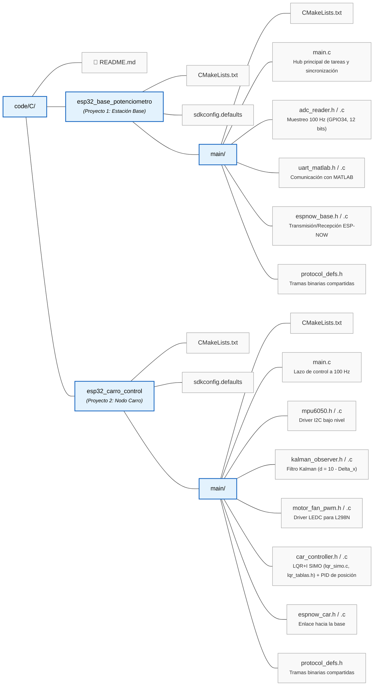

# Firmware ESP32 en C / ESP-IDF con FreeRTOS (Control Carro & Compuerta)

Este directorio contiene los dos proyectos de firmware desarrollados en **C nativo sobre ESP-IDF** utilizando **FreeRTOS**, colas (`xQueue`) y temporizadores no bloqueantes para máxima eficiencia y bajo consumo de memoria RAM/Flash.

---

## Estructura de Directorios



---

## 1. Asignación de Pines Hardware (Pinout)

### Proyecto 1: Estación Base (`esp32_base_potenciometro`)
| Periférico | Pin ESP32 | Descripción |
| :--- | :--- | :--- |
| **Potenciómetro (Cursor)** | `GPIO34` (ADC1_CH6) | Entrada analógica 0.0 V a 3.3 V $\leftrightarrow$ 0° a 180° (conexión directa sin divisor). |
| **Potenciómetro (Extremos)**| `3V3` y `GND` | Alimentación regulada de 3.3V del ESP32. |
| **UART0 TX** | `GPIO1` | Transmisión serial hacia el PC (interfaz de MATLAB). |
| **UART0 RX** | `GPIO3` | Recepción de comandos de consigna desde MATLAB. |
| **ESP-NOW** | Antena Wi-Fi (Canal 1)| Enlace inalámbrico de ultra baja latencia con el carro. |

### Proyecto 2: Nodo Carro (`esp32_carro_control`)
| Actuador / Sensor | Pin ESP32 | Módulo / Conexión |
| :--- | :--- | :--- |
| **IMU MPU6050 SDA** | `GPIO21` | Bus I2C Datos (Pull-up interno/externo a 3.3V). |
| **IMU MPU6050 SCL** | `GPIO22` | Bus I2C Reloj (400 kHz). |
| **Ventilador PWM (ENA)** | `GPIO18` | Entrada de velocidad al Puente H L298N (Alimentación 24 VDC). |
| **Ventilador DIR (IN1/IN2)**| `GPIO19` / `GND` | Sentido fijo de soplado hacia la compuerta. |
| **Motor Izq. PWM (ENA)** | `GPIO25` | PWM de velocidad (Puente H L298N motores a 7.4V Li-Ion). |
| **Motor Izq. IN1 / IN2** | `GPIO27` / `GPIO14` | Dirección avance / retroceso motor izquierdo. |
| **Motor Der. PWM (ENB)** | `GPIO26` | PWM de velocidad (Puente H L298N motores). |
| **Motor Der. IN3 / IN4** | `GPIO32` / `GPIO33` | Dirección avance / retroceso motor derecho (pines seguros sin conflicto de strapping). |

---

## 2. Protocolo de Comunicación

### 2.1 Enlace Serial PC / MATLAB $\leftrightarrow$ Estación Base (115200 Baudios)

* **Telemetría enviada por la Base a MATLAB (100 Hz):**
  ```
  $TEL,<theta_meas>,<dist_est>,<vel_est>,<ax>,<u_fan>,<u_car>,<error_dist>,<status>\n
  ```
  * `theta_meas`: Ángulo medido de la compuerta por el ADC [0.0 - 90.0 °].
  * `dist_est`: Distancia estimada del carro a la compuerta [cm].
  * `vel_est`: Velocidad lineal del carro estimada por Kalman [m/s].
  * `ax`: Aceleración longitudinal medida por el MPU6050 [m/s²].
  * `u_fan`: PWM aplicado al ventilador San Ace 40 [10.0 - 90.0 %].
  * `u_car`: Esfuerzo de los motores de tracción [-100.0 a +100.0 %].
  * `error_dist`: Error de distancia instantáneo $e_d = d_{est} - d_{ref}$ [cm]; $d_{ref}$ la calcula el LQR del carro, así que $d_{ref} = d_{est} - e_d$.
  * `status`: Actuadores realmente encendidos en el carro: bit 0 ventilador, bit 1 motores (`3` = ambos).
  * Si la base no recibe telemetría del carro durante más de 500 ms, los campos del carro se envían en `0`.
  * Tras el arranque la base silencia sus logs (UART0 es compartido con MATLAB); igual conviene ignorar en MATLAB toda línea que no empiece con `$TEL,` (p. ej. el texto del bootloader).

* **Comando enviado por MATLAB a la Base:**
  ```
  $CMD,<theta_ref>,<en_motors>,<en_fan>\n
  ```
  * `theta_ref`: Consigna de ángulo en grados, en $[0, 90]$ (ej. `35.0`).
  * `en_motors`: `1` para habilitar motores, `0` para detenerlos.
  * `en_fan`: `1` para habilitar ventilador, `0` para apagarlo.
  * Los 3 campos son obligatorios y `theta_ref` debe estar en rango; si no, la trama se descarta.
  * No hay consigna de distancia ni PWM desde MATLAB: el **LQR+I SIMO corre en el ESP32 del carro** y calcula el PWM del ventilador y $d_{ref}$.
  * La base arranca con motores y ventilador **apagados** y conserva la última orden recibida: el sistema sigue funcionando aunque se cierre MATLAB.

### 2.2 Emparejamiento ESP-NOW (Base $\leftrightarrow$ Carro)

Por defecto ambos nodos usan broadcast y aceptan paquetes de **cualquier** ESP32 en el canal 1. Para que dos montajes del laboratorio no se crucen:
1. Flashea ambos y lee en `idf.py monitor` la línea `MAC propia (...)` de cada uno.
2. En `main/protocol_defs.h` de **ambos** proyectos pon `BASE_MAC_ADDR` y `CAR_MAC_ADDR` con esas MAC y vuelve a flashear. Cada nodo descarta lo que no venga de su par.

* **Interfaz MATLAB:** `>> gui_esp32` (en `code/MATLAB`) lee `$TEL` y grafica θ, el PWM enviado (con mín/máx y aviso de saturación), la distancia de la IMU con la $d_{ref}$ del LQR y el esfuerzo del carro. Solo envía `$CMD` cuando el usuario cambia la consigna o las casillas; al conectarse muestra el estado real de los actuadores y cerrarla no detiene el sistema (para eso está **PARADA**). Pruebas sin hardware: `runtests('test_gui_esp32')`.

---

## 3. Instrucciones de Compilación y Flasheo con ESP-IDF

Asegúrate de tener el entorno de **ESP-IDF v5.x** (probado contra la API de v5.4; v4.4 no sirve porque falta el componente `esp_adc`) activado en tu terminal:

### Para compilar y subir la Estación Base:
```powershell
cd D:\USC\Proyectos\Car_Control\code\C\esp32_base_potenciometro
idf.py set-target esp32
idf.py build
idf.py -p COM_PUERTO_BASE flash monitor
```

### Para compilar y subir el Nodo del Carro:
```powershell
cd D:\USC\Proyectos\Car_Control\code\C\esp32_carro_control
idf.py set-target esp32
idf.py build
idf.py -p COM_PUERTO_CARRO flash monitor
```
*(Nota: `idf.py monitor` y MATLAB usan el mismo puerto COM de la base; cierra el monitor antes de conectar MATLAB. Al encender el carro, manténlo inmóvil durante los primeros 2 segundos mientras se ejecuta la calibración automática del sesgo en reposo del MPU6050. Si el MPU6050 no responde, los motores quedan deshabilitados).*

### Pruebas en PC (controlador y observador del carro, sin ESP-IDF)
```bash
cd code/C
gcc -I esp32_carro_control/main test/test_control.c esp32_carro_control/main/car_controller.c esp32_carro_control/main/lqr_simo.c esp32_carro_control/main/kalman_observer.c -lm -o test_control && ./test_control
```

Sin `gcc`, la misma prueba corre en un ESP32 emulado con QEMU (una sola vez: `python $env:IDF_PATH\tools\idf_tools.py install qemu-xtensa`, y agregar su carpeta `bin` al `PATH`). Termina imprimiendo `OK: test_control`; se sale con `Ctrl + ]`:
```powershell
idf.py -C code\C\test qemu monitor
```
